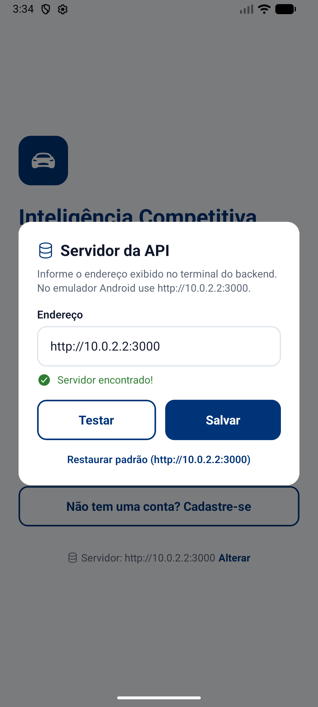
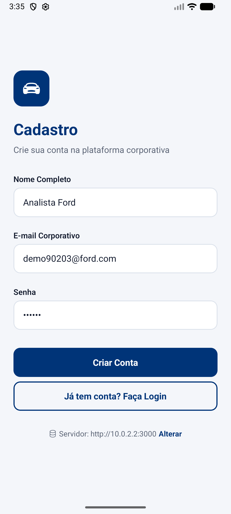
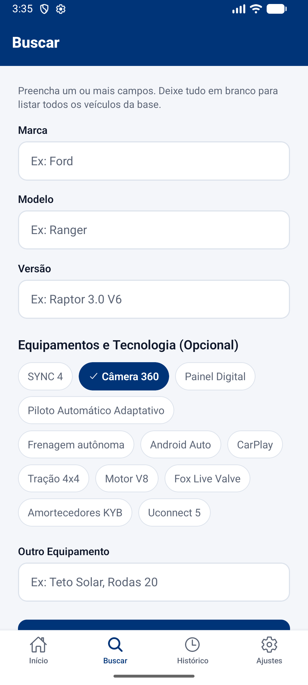
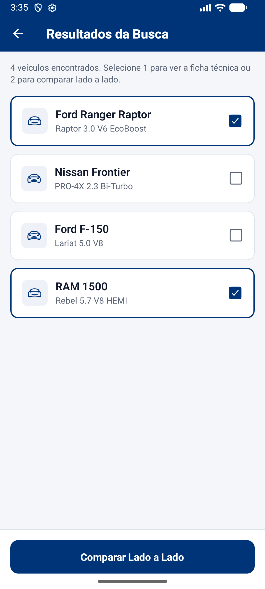
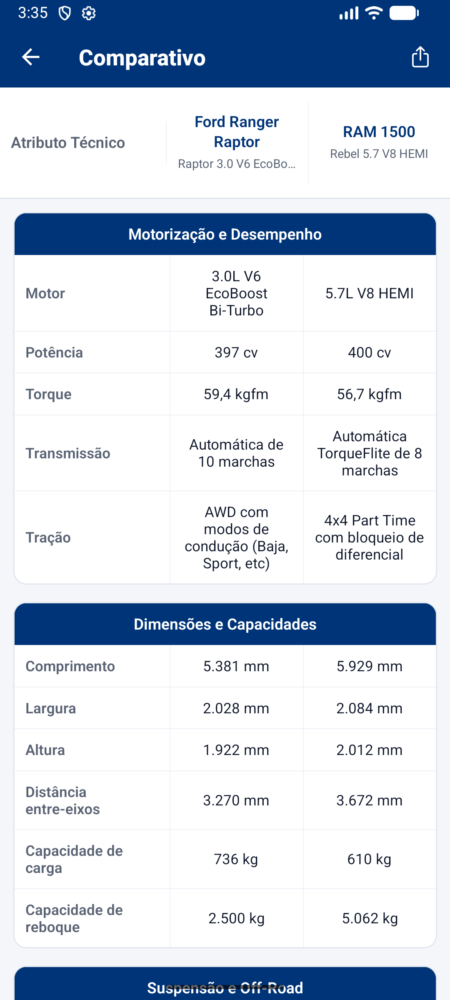
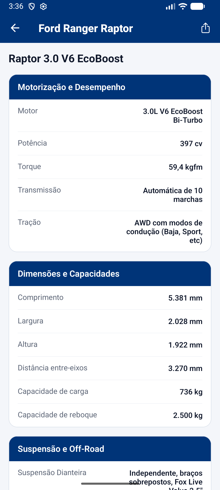
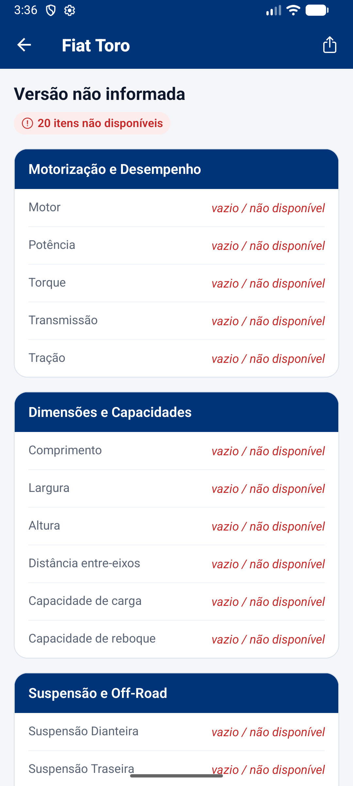
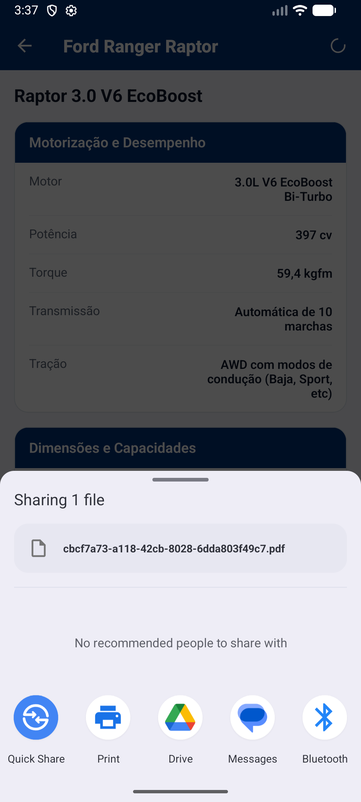
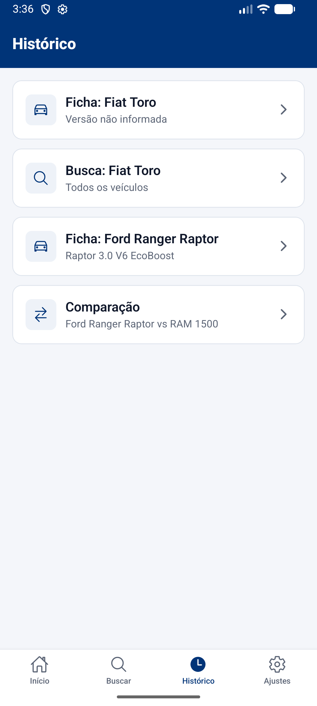

# Inteligência Competitiva — Comparador de Especificações de Pickups

Aplicativo mobile (**React Native + Expo SDK 54**) com API backend (**Node.js + TypeScript + SQLite**) que permite a analistas buscar fichas técnicas padronizadas de pickups, comparar dois veículos lado a lado, identificar equipamentos ausentes nos concorrentes e exportar relatórios em PDF.

> Solução para o **Desafio 01 — Inteligência Competitiva Automotiva (Ford)**. Versão final da **Sprint 3 — Mobile Development and IoT**, distribuída como **APK Android**.

> [!TIP]
> **APK pronto para instalar:** [`releases/inteligencia-competitiva.apk`](releases/inteligencia-competitiva.apk) — veja [Instalando o APK](#-instalando-o-apk).

> [!NOTE]
> **Simulação de Web Scraping:** a API simula a futura coleta automatizada de fichas técnicas de concorrentes. O banco é populado com dados baseados nas informações oficiais e fictícias de pickups disponibilizadas pela Ford para validação do desafio.

---

## 👥 Integrantes do Grupo

| Nome | RM |
|---|---|
| Guilherme Oliveira | 558797 |
| Matheus Dantas | 558804 |
| Rafael Panhoca | 555014 |
| Silas Alves | 555020 |
| Victor Rodriguez | 559094 |

---

## 📌 Entregas da Sprint 3

| Objetivo | Como foi atendido |
|---|---|
| **Versão final publicável em APK**, com todos os fluxos funcionando | APK de release gerado e **testado em emulador Android 16 (API 36)**: cadastro, login, configuração do servidor, busca, resultados, ficha técnica, comparativo, dados ausentes, exportação em PDF, histórico e modo escuro — ver [Validação no APK](#-validação-no-apk). |
| **Identidade visual consolidada** | *Design tokens* únicos em [`src/constants/theme.ts`](sprint-mobile-frontend/src/constants/theme.ts) usados por todas as telas; cabeçalhos na cor da marca; componentes reutilizáveis (`Card`, `ListItemCard`, `EmptyState`, `SectionTitle`, `CustomButton`, `CustomInput`); modo escuro com contraste ajustado; **ícone próprio** (adaptativo e monocromático), splash e PDFs na mesma paleta. |
| **Produto finalizado, código organizado e README completo** | Código de template do Expo removido; lógica de histórico, especificações, PDF e erros extraída para `services/` e `utils/`; lint e TypeScript sem avisos; 25 testes automatizados; este README com capturas reais do APK. |
| **Build final instalável em dispositivo/emulador** | Build **local**, sem depender de conta na Expo ([`scripts/build-apk.ps1`](sprint-mobile-frontend/scripts/build-apk.ps1)); EAS Build também configurado ([`eas.json`](sprint-mobile-frontend/eas.json)). |

### Correções e melhorias desta sprint
- **Servidor configurável no próprio app:** o APK não depende de um IP fixo. Na tela de login (link *Servidor*) ou em *Ajustes*, o usuário informa o endereço do backend e testa a conexão — o mesmo APK funciona no emulador e em qualquer celular da rede.
- **Filtros de equipamento que não encontravam nada:** 7 dos 12 *chips* (ex.: "Motor V8", "Tração 4x4", "Câmera 360") retornavam zero veículos, porque a busca exigia a frase inteira em um único campo. Agora cada palavra é procurada no mesmo item da ficha (rótulo + valor), sem diferenciar acentos — os 12 retornam resultados corretos ([`equipmentMatcher.ts`](sprint-mobile-backend/src/utils/equipmentMatcher.ts), com testes).
- **Ficha de veículo fora da base padronizada:** o modelo "vazio / não disponível" usava categorias em inglês, diferentes das demais fichas; agora segue exatamente a estrutura do gabarito (Ranger Raptor), mantendo a comparabilidade.
- **Ficha técnica errada em cache:** duas versões do mesmo modelo exibiam a mesma ficha.
- **Mensagens de erro claras:** falha de conexão é diferenciada de credenciais inválidas; telas de erro com "Tentar novamente".
- **Seed no build de produção:** o JSON de veículos não era copiado para `dist/`, então `npm start` em um banco novo ficava sem dados.
- Status bar segue o tema do app; confirmação ao sair; estados vazios com ação sugerida; ao marcar um terceiro veículo, o mais antigo é substituído.

---

## 📱 Telas do Aplicativo

Capturas feitas no **APK de release** rodando em emulador Android (pasta [`docs/screenshots/`](docs/screenshots/)).

| Login | Configuração do servidor | Cadastro |
|---|---|---|
|  |  |  |
| Autenticação JWT com validação de campos. | Endereço da API ajustável sem gerar novo APK, com teste de conexão. | Criação de conta com validação. |

| Início | Buscar | Resultados |
|---|---|---|
|  |  |  |
| Saudação, atalhos, veículo em destaque e buscas recentes. | Marca, modelo, versão e *chips* de equipamentos. | Selecione 1 veículo para a ficha ou 2 para comparar. |

| Comparativo | Ficha Técnica | Dados ausentes |
|---|---|---|
|  |  |  |
| Ranger Raptor vs RAM 1500 com atributos alinhados. | Ficha padronizada em 4 categorias. | Veículo fora da base: mesma estrutura, itens em vermelho. |

| Exportação em PDF | Histórico | Ajustes | Modo Escuro |
|---|---|---|---|
|  |  |  |  |
| PDF gerado e compartilhado. | Buscas, fichas e comparações. | Foto, tema, histórico, servidor e logout. | Tema escuro persistido. |

---

## 🎯 Alinhamento com o Desafio

### 1. Entrada simples e busca flexível
A tela [Buscar](sprint-mobile-frontend/src/app/(tabs)/search.tsx) oferece campos de **Marca**, **Modelo** e **Versão**, *chips* de multisseleção para equipamentos e um campo livre para atributos adicionais. A busca por equipamento ignora acentos e maiúsculas e encontra o termo mesmo quando dividido entre o nome e o valor do atributo (ex.: "Motor V8" → *Motor: 5.0L V8 Coyote*).

### 2. Saída padronizada
Qualquer veículo — inclusive um que não está na base — retorna na mesma estrutura de categorias ([Ficha Técnica](sprint-mobile-frontend/src/app/result/[id].tsx)):
*Motorização e Desempenho*, *Dimensões e Capacidades*, *Suspensão e Off-Road*, *Tecnologia e Segurança*. No backend ([vehicles.controller.ts](sprint-mobile-backend/src/controllers/vehicles.controller.ts)) as especificações são persistidas sob o mesmo padrão via TypeORM.

### 3. Dados ausentes explícitos
Se um equipamento não existe ou a marca/modelo não está na base, o backend retorna `"vazio / não disponível"` ([raptor.mock.ts](sprint-mobile-backend/src/data/raptor.mock.ts)). O app exibe esses campos em **vermelho e itálico**, e a ficha mostra quantos itens estão ausentes.

### 4. Comparador lado a lado
O [Comparativo](sprint-mobile-frontend/src/app/result/compare.tsx) alinha os atributos equivalentes de dois veículos, facilitando identificar lacunas entre a Ranger Raptor e as rivais.

### 5. Gabarito de validação
A base inclui a **Ford Ranger Raptor** (Fox Live Valve, SYNC 4, motor 3.0 V6 EcoBoost...) e concorrentes:
Toyota Hilux GR-Sport · Volkswagen Amarok Extreme V6 · Chevrolet S10 High Country · Nissan Frontier PRO-4X · Mitsubishi L200 Triton Sport · Ford F-150 Lariat V8 · RAM 1500 Rebel V8.

### 6. Diferenciais
- **Exportação para PDF** da ficha e do comparativo, com a identidade visual do app.
- **Histórico local** por usuário (`AsyncStorage`).
- **Logs de pesquisa** (`BUSCA_VEICULO`) gravados no banco para auditoria.
- **Autenticação JWT** e **testes automatizados (Jest)** no frontend e backend.

---

## 🏗️ Arquitetura

```
sprint-mobile/
├── releases/                       APK final (inteligencia-competitiva.apk)
├── docs/screenshots/               Capturas do APK em execução
├── sprint-mobile-backend/          API REST (Express + TypeORM + SQLite)
│   └── src/
│       ├── config/                 Conexão com o banco e seed dos veículos
│       ├── controllers/            Regras de autenticação e busca (+ testes)
│       ├── data/                   Base de veículos e modelo de ficha vazia
│       ├── entities/               User, Vehicle, SearchLog
│       ├── middlewares/            Validação do token JWT
│       ├── routes/                 /api/auth e /api/vehicles
│       └── utils/                  Busca por equipamentos (+ testes)
│
└── sprint-mobile-frontend/         App React Native (Expo Router)
    ├── app.json / eas.json         Configuração do app e do build
    ├── assets/                     Ícones, splash e fonte do ícone (SVG)
    ├── scripts/build-apk.ps1       Build local do APK (sem EAS)
    └── src/
        ├── app/                    Telas (rotas do Expo Router)
        │   ├── auth/               Login e Cadastro
        │   ├── (tabs)/             Início, Buscar, Histórico, Ajustes
        │   └── result/             Resultados, Ficha Técnica, Comparativo
        ├── components/ui/          Componentes visuais reutilizáveis (+ testes)
        ├── constants/theme.ts      Design tokens (cores, espaçamento, tipografia)
        ├── contexts/               AuthContext e ThemeContext
        ├── hooks/                  useAuth, useTheme, useHeaderOptions
        ├── services/               Cliente HTTP (api.ts) e histórico local
        ├── types/                  Tipagens compartilhadas
        └── utils/                  Especificações, PDF e mensagens de erro
```

### Identidade visual

| Token | Claro | Escuro | Uso |
|---|---|---|---|
| `primary` | `#003478` | `#3D7BE0` | Cabeçalhos, botões, destaques |
| `secondary` | `#F59E0B` | `#F59E0B` | Acentos (destaque, foto de perfil) |
| `background` | `#F4F6FA` | `#0B1220` | Fundo das telas |
| `surface` | `#FFFFFF` | `#151E2E` | Cards e listas |
| `error` | `#C62828` | `#EF5350` | Erros e itens "não disponível" |

Espaçamentos em escala de 4 (`4, 8, 12, 16, 24, 32`), raios `8/12/16` e tipografia em 6 níveis (`display`, `title`, `subtitle`, `body`, `label`, `caption`). O ícone do app (picape estilizada em azul Ford com detalhe âmbar) tem a fonte vetorial em [`assets/brand/icon.svg`](sprint-mobile-frontend/assets/brand/icon.svg).

---

## 🛠️ Tecnologias

**Backend:** Node.js, TypeScript, Express 5, TypeORM, SQLite, Zod, JWT, bcrypt, Jest + Supertest.

**Frontend:** React Native 0.81, Expo SDK 54, Expo Router, TanStack Query, Axios, AsyncStorage, Context API, Reanimated, expo-print / expo-sharing (PDF), expo-image-picker, Ionicons, Jest + Testing Library.

---

## 📲 Instalando o APK

O app consome a API, então o **backend precisa estar rodando** no computador.

### 1. Inicie o backend
```bash
cd sprint-mobile-backend
npm install
npm run dev
```
O terminal mostra os endereços de acesso, por exemplo:
```
Server is running on port 3000
Acessível na rede local em: http://192.168.15.12:3000
```

### 2. Instale o APK
- **Emulador Android:** arraste [`releases/inteligencia-competitiva.apk`](releases/inteligencia-competitiva.apk) para a janela do emulador (ou `adb install releases/inteligencia-competitiva.apk`). **Nenhuma configuração extra** — o APK já aponta para `http://10.0.2.2:3000`, que é o computador visto de dentro do emulador.
- **Celular físico:** copie o `.apk` para o aparelho, abra-o e permita "instalar apps desconhecidos". O celular precisa estar **na mesma rede Wi-Fi** do computador.

### 3. Aponte para o servidor (apenas celular físico)
Na tela de login, toque em **Servidor → Alterar**, informe o endereço exibido pelo backend (ex.: `http://192.168.15.12:3000`), toque em **Testar** e depois em **Salvar**. O endereço fica salvo e pode ser alterado depois em **Ajustes → Servidor da API**.

> [!WARNING]
> Se o teste de conexão falhar no celular, libere a porta 3000 no Firewall do Windows (ou teste com o firewall desativado temporariamente) e confirme que os dois aparelhos estão na mesma rede.

### 4. Use o app
Crie uma conta em **Cadastre-se**, faça login e explore: busque por equipamentos, selecione dois veículos para o comparativo e exporte a ficha em PDF.

---

## 🔧 Gerando o APK

### Opção A — Build local (sem conta na Expo)
Requer **Android Studio** instalado (fornece o JDK e o Android SDK) e Windows.
```bash
cd sprint-mobile-frontend
npm install
npm run build:apk:local
```
O script [`build-apk.ps1`](sprint-mobile-frontend/scripts/build-apk.ps1) espelha o projeto em `C:\sm-apk-build` (a compilação nativa ultrapassa o limite de 260 caracteres de caminho do Windows em pastas profundas), gera o projeto nativo, compila com Gradle e copia o resultado para `releases/inteligencia-competitiva.apk`. A primeira execução leva de 10 a 20 minutos. Para embutir outro endereço padrão da API:
```powershell
powershell -ExecutionPolicy Bypass -File scripts\build-apk.ps1 -ApiUrl http://192.168.0.10:3000
```

### Opção B — EAS Build (na nuvem)
```bash
npm install -g eas-cli
cd sprint-mobile-frontend
eas login                 # conta gratuita em expo.dev
npm run build:apk         # = eas build -p android --profile preview
```
O endereço padrão da API fica em `EXPO_PUBLIC_API_URL`, no perfil `preview` do [`eas.json`](sprint-mobile-frontend/eas.json). Ao final, o terminal mostra um link para baixar o `.apk`.

---

## 💻 Executando em desenvolvimento

> [!IMPORTANT]
> Para facilitar a avaliação, o backend usa **SQLite local** (`database.sqlite`) e configurações fixas (porta 3000, segredo JWT). **Não é necessário `.env` nem PostgreSQL.**

Com o backend rodando (`npm run dev`):
```bash
cd sprint-mobile-frontend
npm install
npm start
```
- **Expo Go (celular):** escaneie o QR Code — o app descobre o IP do backend automaticamente.
- **Emulador:** pressione `a` (Android) ou `i` (iOS).
- **Web:** pressione `w`.

---

## ✅ Validação no APK

O APK de release foi instalado em um emulador **Android 16 (API 36)** com o backend local, e os fluxos abaixo foram executados de ponta a ponta — as capturas da seção [Telas do Aplicativo](#-telas-do-aplicativo) são dessa execução:

| Fluxo | Resultado |
|---|---|
| Configurar e testar o servidor da API | ✅ |
| Cadastro e login | ✅ |
| Busca por equipamento (*chip* "Câmera 360") | ✅ 4 veículos |
| Seleção de 2 veículos e comparativo lado a lado | ✅ |
| Ficha técnica individual | ✅ |
| Veículo fora da base (Fiat Toro) com dados ausentes padronizados | ✅ |
| Exportação da ficha em PDF | ✅ |
| Histórico, Início e Ajustes | ✅ |
| Modo escuro | ✅ |

Os 12 *chips* de equipamento também foram verificados contra a API: todos retornam ao menos um veículo.

---

## 🧪 Qualidade

```bash
# Backend — 17 testes (autenticação, busca, filtro de equipamentos)
cd sprint-mobile-backend
npm test

# Frontend — 8 testes de componentes
cd sprint-mobile-frontend
npm test
npm run typecheck   # TypeScript sem erros
npm run lint        # ESLint sem avisos
npx expo-doctor     # 18/18 verificações do Expo
```
